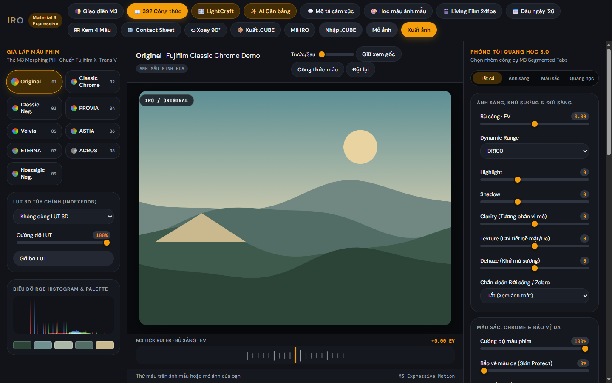
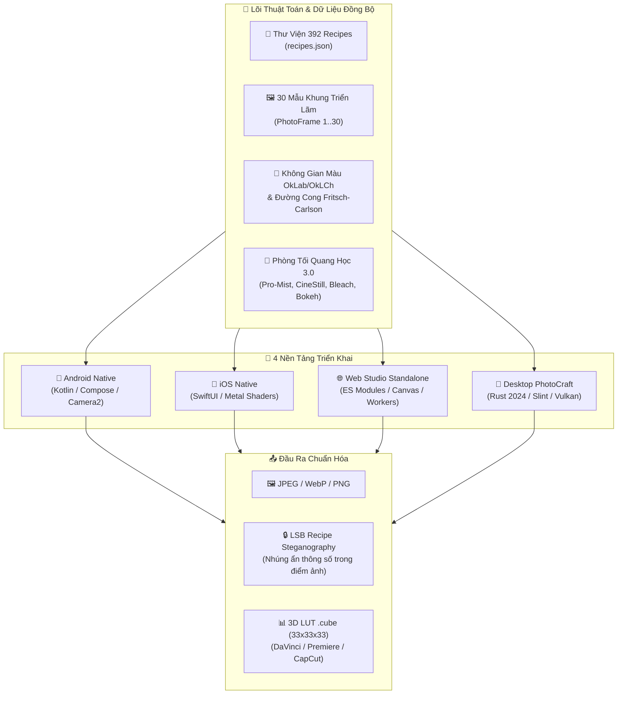

# IRO Studio 3.0 — Hệ Sinh Thái Phòng Tối & Giả Lập Màu Phim Đa Nền Tảng

<p align="center">
  
</p>

<p align="center">
  <b>Hệ thống phòng tối xử lý ảnh quang học, giả lập 392 công thức màu phim Fujifilm và 30 mẫu khung ảnh triển lãm đồng bộ toán học trên 4 nền tảng: Android, iOS, Web và Desktop.</b>
</p>

<p align="center">
  
  
  
  
  
  
  
  
</p>

---

## 📑 Mục lục phân loại hệ thống

1. [Bản đồ phân loại kiến trúc hệ sinh thái](#-bản-đồ-phân-loại-kiến-trúc-hệ-sinh-thái)
2. [Cấu trúc thư mục mã nguồn chuẩn hóa](#-cấu-trúc-thư-mục-mã-nguồn-chuẩn-hóa)
3. [Bảng ma trận tính năng đồng bộ 4 nền tảng](#-bảng-ma-trận-tính-năng-đồng-bộ-4-nền-tảng)
4. [Danh mục 30 mẫu khung ảnh triển lãm (PhotoFrame 1..30)](#-danh-mục-30-mẫu-khung-ảnh-triển-lãm-photoframe-130)
5. [Thư viện 392 công thức màu Fujifilm theo cảm biến](#-thư-viện-392-công-thức-màu-fujifilm-theo-cảm-biến)
6. [Hướng dẫn khởi chạy & triển khai theo từng nền tảng](#-hướng-dẫn-khởi-chạy--triển-khai-theo-từng-nền-tảng)
   - [📱 1. Mobile Android (Android Studio)](#-1-mobile-android-android-studio)
   - [🍏 2. Mobile iOS (Xcode & SwiftUI)](#-2-mobile-ios-xcode--swiftui)
   - [🌐 3. Web Studio (Standalone Node / Docker / Nginx)](#-3-web-studio-standalone-node--docker--nginx)
   - [🦀 4. Desktop Suite (PhotoCraft Rust)](#-4-desktop-suite-photocraft-rust)
7. [Quy trình kiểm thử & tự động hóa CI/CD](#-quy-trình-kiểm-thử--tự-động-hóa-cicd)

---

## 🏛 Bản đồ phân loại kiến trúc hệ sinh thái



---

## 📂 Cấu trúc thư mục mã nguồn chuẩn hóa

Dự án được phân loại rành mạch theo từng nền tảng, độc lập và có thể chạy riêng biệt:

```text
photoedit/
├── android/                         # 📱 NỀN TẢNG MOBILE ANDROID
│   ├── app/                         # Mã nguồn ứng dụng Android chính (Java & Kotlin)
│   │   ├── src/main/java/vn/iro/editor/
│   │   │   ├── MainActivity.java    # Giao diện MD3 Expressive Darkroom Studio
│   │   │   ├── ColorEngine.java     # Lõi xử lý màu sắc & bộ lọc quang học 3.0
│   │   │   ├── LightCraftEngine.java# Fritsch-Carlson Tone Curves & OkLab Wheels
│   │   │   ├── PhotoFrame.java      # Render 30 mẫu khung ảnh triển lãm
│   │   │   ├── Recipe.java          # Parser công thức màu & giải mã LSB
│   │   │   ├── AutoBalancer.java    # Cân bằng trắng & đo sáng tự động
│   │   │   └── CubeLut.java         # Nạp & nội suy bảng màu 3D LUT
│   │   └── src/main/assets/         # Tài nguyên assets: recipes.json, ảnh mẫu fujixweekly
│   ├── desktop/                     # Ứng dụng Desktop JavaFX/Swing dự phòng
│   └── tools/                       # Bộ công cụ kiểm thử & đồng bộ Git Android
│       ├── check.ps1                # Kiểm tra tự động 27 engine checks + sizing + catalog
│       ├── sync-git.ps1             # Đồng bộ 2 chiều tự động giữa workspace và repo
│       └── catalog.test.mjs         # Kiểm thử toàn vẹn 392 recipes
│
├── ios/                             # 🍏 NỀN TẢNG MOBILE IOS
│   ├── IRO.xcodeproj                # Dự án Xcode 15+ native
│   ├── IRO/
│   │   ├── App/                     # Lifecycle & State Model (EditorModel.swift, IROApp.swift)
│   │   ├── Core/                    # Lõi tính toán màu Swift (ColorEngine, LightCraftEngine)
│   │   ├── Imaging/                 # Render 30 khung ảnh (PhotoFrame.swift) & EXIF IO
│   │   ├── Library/                 # Quản lý kho công thức và LUT online
│   │   ├── Resources/               # Tài nguyên: recipes.json, PrivacyInfo.xcprivacy
│   │   └── Views/                   # Giao diện SwiftUI (EditorView, LightCraftViews, FrameExport)
│   └── Tests/                       # Bộ kiểm thử đơn vị & kiểm thử tương thích với Android
│
├── web/                             # 🌐 NỀN TẢNG WEB STUDIO (STANDALONE PACKAGE)
│   ├── index.html                   # Giao diện web phòng tối chuẩn MD3 Expressive
│   ├── style.css                    # Bảng định kiểu Darkroom theme hiện đại
│   ├── app.mjs                      # Điều khiển giao diện, bánh xe màu, canvas curve
│   ├── engine.mjs                   # Lõi xử lý hình ảnh 100% Client-side, 30 khung, 392 recipes
│   ├── worker.mjs                   # Web Worker xử lý ảnh bất đồng bộ ngoài luồng chính
│   ├── recipes.json                 # Thư viện 392 công thức màu Fujifilm
│   ├── tests.mjs                    # Bộ 8 kiểm thử đơn vị tự động Node.js
│   ├── server.mjs                   # Máy chủ Node.js hiệu năng cao (Gzip, Cache, Security)
│   ├── Dockerfile                   # Khởi tạo container Docker chạy độc lập
│   ├── docker-compose.yml           # Khởi chạy dịch vụ chỉ với 1 lệnh
│   ├── nginx.conf                   # Cấu hình máy chủ web Nginx tối ưu
│   ├── .htaccess                    # Cấu hình Apache cho Shared Host cPanel
│   ├── package.json                 # Cấu hình NPM package
│   └── DEPLOY.md                    # Sổ tay triển khai Server VPS / Debian / Cloudflare
│
├── dist/                            # 📦 STATIC DISTRIBUTION BUNDLE
│   └── (Bản build tĩnh phục vụ CDN hoặc hosting tĩnh)
│
├── package.json                     # NPM root quản lý kiểm thử chung
├── tests.mjs                        # Root unit test runner (8 suites)
└── README.md                        # Tài liệu đặc tả phân loại kiến trúc toàn diện
```

---

## 📊 Bảng ma trận tính năng đồng bộ 4 nền tảng

Mọi thuật toán cốt lõi đều được bảo đảm đồng bộ toán học 1:1 trên mọi nền tảng:

| Nhóm tính năng | Chi tiết tính năng | Android Native | iOS Native | Web Studio | Desktop Rust |
|---|---|:---:|:---:|:---:|:---:|
| **Thư viện màu phim** | 392 Fuji X Weekly Recipes (`recipes.json`) | ✅ | ✅ | ✅ | ✅ |
| | Bộ lọc cảm biến (Bayer, X-Trans III, IV, V, GFX) | ✅ | ✅ | ✅ | ✅ |
| | Tìm kiếm & nạp công thức 1 chạm | ✅ | ✅ | ✅ | ✅ |
| **Khung ảnh triển lãm** | Đầy đủ 30 mẫu khung nghệ thuật (Style ID 1..30) | ✅ | ✅ | ✅ | ✅ |
| | Định dạng thông số EXIF (Camera, Lens, ISO, F-stop) | ✅ | ✅ | ✅ | ✅ |
| | Trích xuất dải màu 5 ô (Color Palette Strip) | ✅ | ✅ | ✅ | ✅ |
| **LightCraft Suite** | Fritsch–Carlson 5-Point Monotone Tone Curve | ✅ | ✅ | ✅ | ✅ |
| | 3-Way Color Wheels (OkLab / OkLCh perceptual) | ✅ | ✅ | ✅ | ✅ |
| | Cân bằng trắng tự động (Auto White Balance / Gray World) | ✅ | ✅ | ✅ | ✅ |
| **Phòng tối quang học 3.0** | Black Pro-Mist Bloom (Khuếch tán vùng sáng) | ✅ | ✅ | ✅ | ✅ |
| | CineStill 800T Halation (Quầng đỏ tương phản cao) | ✅ | ✅ | ✅ | ✅ |
| | Bleach Bypass (Giữ bạc điện ảnh cao độ tương phản) | ✅ | ✅ | ✅ | ✅ |
| | Helios 44-2 Swirly Bokeh (Xoáy mờ quang học cổ điển) | ✅ | ✅ | ✅ | ✅ |
| | Dehaze & Clarity & Texture tái tạo vi chi tiết | ✅ | ✅ | ✅ | ✅ |
| | Light Leak 35mm (Rò sáng góc phim ngẫu nhiên) | ✅ | ✅ | ✅ | ✅ |
| | Hạt muối bạc Dual-Band Grain & Chuyển động 24fps | ✅ | ✅ | ✅ | ✅ |
| **Bảo mật & Xuất file** | 100% Xử lý Offline tại chỗ (Zero cloud upload) | ✅ | ✅ | ✅ | ✅ |
| | Xuất file ảnh Ultra HD 4K (JPEG, PNG, WebP) | ✅ | ✅ | ✅ | ✅ |
| | Giấu/Đọc công thức ẩn LSB Steganography trong PNG | ✅ | ✅ | ✅ | ✅ |
| | Xuất bảng màu 3D LUT `.cube` 33×33×33 chuyên nghiệp | ✅ | ✅ | ✅ | ✅ |

---

## 🖼 Danh mục 30 mẫu khung ảnh triển lãm (PhotoFrame 1..30)

Hệ thống khung ảnh triển lãm được định danh chuẩn xác từ ID `1` đến `30` trên cả 3 nền tảng code (`PhotoFrame.java`, `PhotoFrame.swift`, `engine.mjs`):

| ID | Mã khung | Tên tiếng Việt | Phân loại | Đặc điểm bố cục & EXIF |
|:---:|---|---|---|---|
| `1` | `Classic` | Cổ điển Polaroid | Cơ bản | Viền trắng dày phía dưới, hiển thị Camera + Lens |
| `2` | `White` | Viền trắng tinh giản | Cơ bản | Viền mỏng 4 cạnh đều nhau, thanh lịch |
| `3` | `Glass` | Thủy tinh mờ ảo | Cơ bản | Hiệu ứng kính mờ frosted glass đổ bóng |
| `4` | `Dark` | Phòng tối đen sâu | Cơ bản | Nền đen sâu điện ảnh tương phản cao |
| `5` | `Centered` | Tiêu điểm trung tâm | Cơ bản | Bố cục căn chính giữa với thông số đối xứng |
| `6` | `Gallery` | Bảo tàng triển lãm | Mở rộng | Khung bo đôi tiêu chuẩn gallery nghệ thuật |
| `7` | `Noir` | Điện ảnh Noir | Mở rộng | Tông màu đen trắng điện ảnh cổ điển |
| `8` | `Instant` | Ảnh chụp lấy liền | Mở rộng | Mô phỏng ảnh chụp lấy liền với viền hóa chất |
| `9` | `Vintage` | Phim cũ hoài niệm | Mở rộng | Tông màu giấy ố vàng nhẹ hoài niệm |
| `10` | `Film35` | Thước phim 35mm | Mở rộng | Có răng cưa đục lỗ (sprocket holes) 35mm hai bên |
| `11` | `Cinema` | Màn bạc 21:9 | Mở rộng | Dải đen letterbox điện ảnh trên dưới |
| `12` | `Blur` | Hậu cảnh làm mờ | Mở rộng | Dùng chính ảnh gốc làm mờ Gaussian nền |
| `13` | `Palette` | Bảng màu 5 ô | Mở rộng | 5 ô màu trích xuất tự động từ dải màu chính của ảnh |
| `14` | `Postcard` | Bưu thiếp du lịch | Mở rộng | Bố cục tem thư và con dấu bưu điện |
| `15` | `Editorial` | Tạp chí thời trang | Mở rộng | Typography thanh mảnh phong cách Vogue/Kinfolk |
| `16` | `Double` | Khung viền kép | Mở rộng | Viền đôi tinh xảo mạ vàng/đen |
| `17` | `Date` | Đồng hồ LED cam | Mở rộng | Chữ số LED cam góc phải kiểu máy ảnh compact 90s |
| `18` | `Signature` | Chữ ký tác giả | Mở rộng | Đường gạch chỉ và khoảng trống ký tên tác phẩm |
| `19` | `Float` | Ảnh nổi 3D | Nghệ thuật | Đổ bóng đa lớp tạo cảm giác ảnh nổi trên mặt giấy |
| `20` | `Soft` | Viền mờ dịu nhẹ | Nghệ thuật | Viền mờ chuyển sắc êm ái feather gradient |
| `21` | `Torn` | Giấy xé thủ công | Nghệ thuật | Mép giấy xé răng cưa ngẫu nhiên phong cách scrapbooking |
| `22` | `Tape` | Băng dính Washi | Nghệ thuật | Dán 4 góc bằng băng keo đục tự nhiên |
| `23` | `Wood` | Khung vân gỗ sồi | Nghệ thuật | Viền gỗ tự nhiên sang trọng cho tranh treo tường |
| `24` | `Gold` | Khung mạ vàng | Nghệ thuật | Viền chỉ vàng hoàng gia óng ánh |
| `25` | `Neon` | Ánh sáng Cyber Neon | Nghệ thuật | Viền phát sáng rực rỡ phong cách Cyberpunk |
| `26` | `Notebook` | Sổ tay ghi chép | Nghệ thuật | Nền giấy kẻ ô ly với gáy lò xo xoắn |
| `27` | `Ticket` | Vé xem phim Retro | Nghệ thuật | Bo góc khuyết và mã vạch vé điện ảnh |
| `28` | `Blueprint` | Bản vẽ kiến trúc | Nghệ thuật | Nền xanh dương Cyanotype với lưới tọa độ kỹ thuật |
| `29` | `Arch` | Khung vòm La Mã | Nghệ thuật | Bo vòm cong cổ điển thanh thoát phần trên |
| `30` | `Corners` | Góc cài album ảnh | Nghệ thuật | 4 góc cài ảnh tam giác cổ điển như album xưa |

---

## 🎞 Thư viện 392 công thức màu Fujifilm theo cảm biến

Tập hợp đầy đủ 392 công thức được tinh chỉnh công phu từ kho tàng Fuji X Weekly:

| Thế hệ cảm biến | Dòng máy tiêu biểu | Số lượng recipes | Các giả lập nổi bật |
|---|---|:---:|---|
| **BAYER** | X-T100, X-T200, X-A series, X100 nguyên bản | **78** | Classic Chrome, Astia, Provia, Velvia, Golden Negative |
| **X-TRANS III** | X-Pro2, X-T2, X-T20, X100F, X-E3 | **85** | Classic Chrome, Acros Green/Red, Kodachrome 64, Portra 400 |
| **X-TRANS IV** | X-T3, X-T30, X-Pro3, X100V, X-S10, X-E4 | **124** | Classic Neg., Eterna Bleach Bypass, Nostalgic Neg., CineStill 800T |
| **X-TRANS V** | X-T5, X-H2, X-H2s, X-S20, X100VI | **73** | Reala Ace, Nostalgic Neg., Acros Yellow, Pacific Blues |
| **GFX** | GFX 50S, GFX 50R, GFX 100, GFX 100S, GFX 100 II | **32** | Medium Format Color, GFX Classic Chrome 65:24, Kodachrome II |

---

## 🚀 Hướng dẫn khởi chạy & triển khai theo từng nền tảng

### 📱 1. Mobile Android (Android Studio)
- **Môi trường yêu cầu:** Android Studio Koala/Ladybug, Android SDK Platform 35.
- **Lưu ý cấu hình JDK:** Luôn sử dụng JDK 21 tích hợp của Android Studio:
  ```powershell
  $env:JAVA_HOME = "C:\Program Files\Android\Android Studio\jbr"
  ```
- **Mở dự án:** Chọn mở thư mục `android/` trong Android Studio.
- **Build APK:**
  ```powershell
  cd android
  .\gradlew.bat assembleDebug
  ```

### 🍏 2. Mobile iOS (Xcode & SwiftUI)
- **Môi trường yêu cầu:** macOS Sonoma/Sequoia, Xcode 15 trở lên, iOS Deployment Target 17.0+.
- **Mở dự án:**
  ```bash
  cd ios
  open IRO.xcodeproj
  ```
- **Chạy kiểm thử:** Nhấn `Cmd + U` hoặc chạy `./Tests/run-core-checks.sh`.

### 🌐 3. Web Studio (Standalone Node / Docker / Nginx)
Thư mục `web/` là gói web độc lập hoàn chỉnh:
- **Khởi chạy nhanh với Node.js:**
  ```bash
  cd web
  node server.mjs
  # Mở trình duyệt: http://localhost:4173
  ```
- **Khởi chạy bằng Docker Compose:**
  ```bash
  cd web
  docker compose up -d
  ```
- **Triển khai Server VPS / Nginx / Cloudflare:**
  Xem hướng dẫn chi tiết từng bước tại [web/DEPLOY.md](web/DEPLOY.md).
- **Tải trọn bộ file Zip sẵn sàng up hosting:** Sử dụng file `iro-web-production.zip`.

### 🦀 4. Desktop Suite (PhotoCraft Rust)
- Dự án được tích hợp tương thích với bộ phần mềm đồ họa mã nguồn mở [cnttdlpt/photocraft](https://github.com/cnttdlpt/photocraft).
- **Build phiên bản Desktop:**
  ```bash
  cargo build --release
  ```

---

## 🧪 Quy trình kiểm thử & tự động hóa CI/CD

Trước mỗi lần đẩy mã nguồn lên GitHub, toàn bộ hệ thống đều trải qua 3 vòng kiểm tra nghiêm ngặt:

1. **Kiểm tra Native Android Engine (`tools/check.ps1`):**
   ```powershell
   powershell -ExecutionPolicy Bypass -File tools/check.ps1
   ```
   - Xác thực 27 native engine checks (`EngineTest.java`).
   - Xác thực 6 export sizing & DPI checks (`ExportSizingTest.java`).
   - Xác thực tính toàn vẹn 392 recipes (`catalog.test.mjs`).
   - Tự động dọn dẹp bộ nhớ tạm `tools/build`.

2. **Kiểm tra Web Studio Engine (`tests.mjs`):**
   ```bash
   node --test web/tests.mjs
   ```
   - Đạt 8/8 unit tests: Identity LUT, Clamping, Optical Darkroom, Prompt NLP tiếng Việt, Giấu công thức LSB Steganography, 30 PhotoFrames và 3-Way Color Grading.

3. **Đồng bộ và đẩy code lên GitHub (`tools/sync-git.ps1`):**
   ```powershell
   powershell -ExecutionPolicy Bypass -File tools/sync-git.ps1 -Push -Message "refactor: standardize project structure and classify multi-platform codebase"
   ```

---

## 🏷️ GitHub Topics & Phân loại gợi ý
Để tối ưu hóa tìm kiếm và phân loại trên GitHub, repo được gắn các tags:
`fujifilm` · `film-simulation` · `photo-editor` · `color-grading` · `lut-cube` · `android-app` · `ios-swift` · `metal-shaders` · `web-darkroom` · `photocraft` · `oklab` · `photo-frame` · `exif`

---

<p align="center">
  Phát triển với sự đam mê màu phim truyền thống và công nghệ quang học hiện đại.<br>
  <b>IRO Studio Team · 2026</b>
</p>
